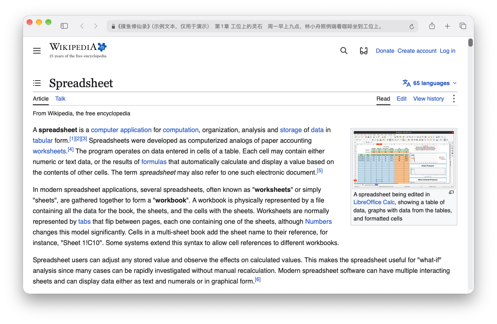
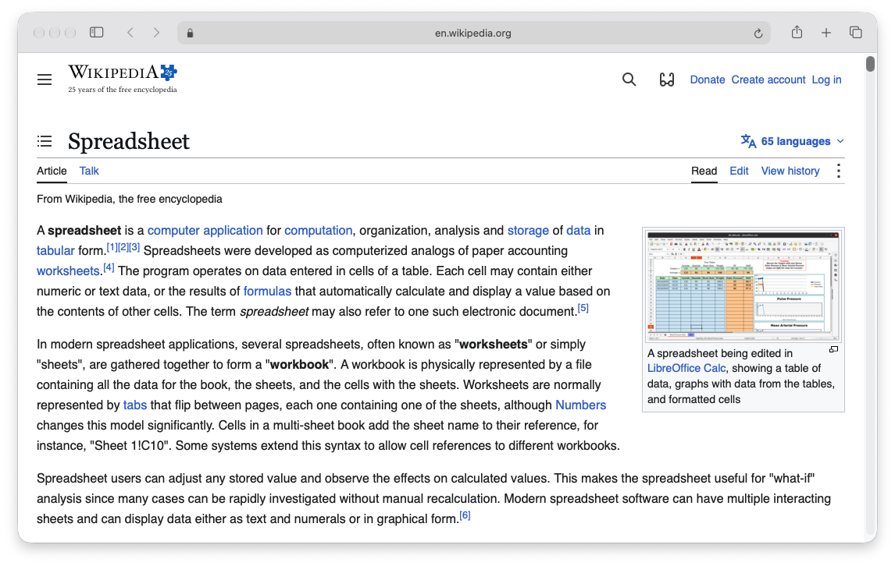
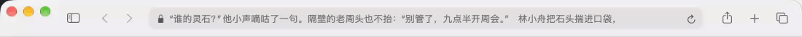
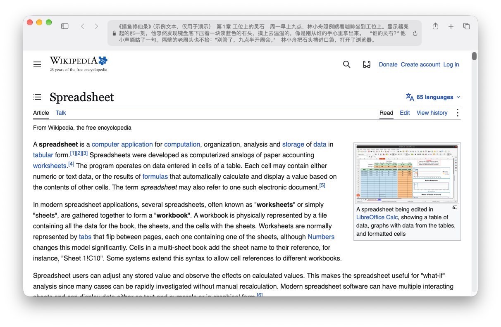
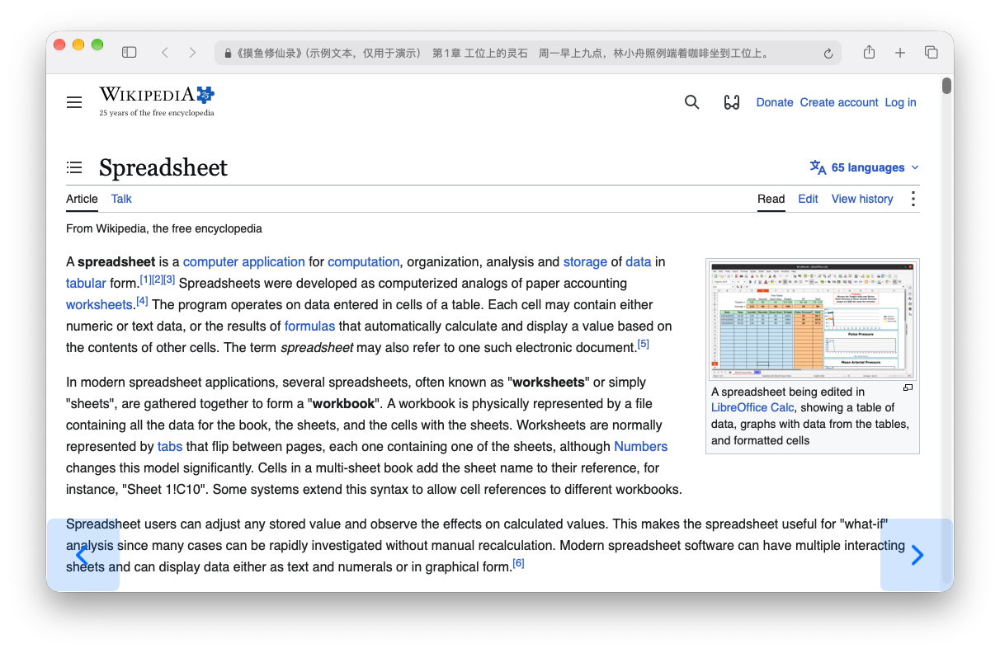
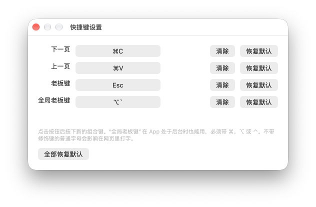

# 真摸鱼神器浏览器（Mac）

一个长得像 Safari 的 macOS 浏览器。平时可以正常上网，但地址栏里显示的是你正在看的 txt 小说。有人走过来，按一下 Esc，地址栏就变回普通网址。

| 平时：地址栏里是小说 | 按下 Esc：变回普通网址 |
|---|---|
|  |  |

市面上的「摸鱼阅读器」大多是一个单独的小窗口，或者伪装成代码、表格。可它终究是一个多出来的窗口，被人多看一眼就露馅了。这个项目换了个思路：**不再多开一个可疑的窗口，而是把小说藏进你每天本来就开着的浏览器里。** 浏览器是办公室里最理所当然的软件，地址栏是最不引人注意的那一条，没有人会盯着别人的地址栏看。

## 设计理念

**1. 它首先是一个真浏览器**
能正常打开网页、登录、下载、上传文件，日常办公完全可以用它来做。小说只占用地址栏那一条，不影响你干正事。也正因为它真的能用，被人看到时才不会有破绽。

**2. 像素级伪装成 Safari**
窗口按钮、工具栏图标、地址栏的圆角和颜色都照着 Safari 做。菜单栏也是 File / Edit / View / History / Bookmarks 这一套，所有阅读设置都藏在 Bookmarks 菜单里。有些地方也身兼二职：「边栏」按钮其实是跳转章节，地址栏左边的小锁其实是自动浏览的开关。

**3. 宁可多藏，不可漏看**
切到别的 App 时小说会自动隐藏，切回来**不会**自动恢复，必须你自己按 Esc。这样就算你忘了，后台露出来的窗口也只是一个普通网页。老板键是瞬间切换，不带任何动画，紧急时一秒都不耽误。

**4. 远处看不出异样**
文字默认用浅灰色，和真实地址栏里网址的颜色差不多；换页时淡入淡出，远看不会一闪一闪；每页只在标点处结束，不会出现半句话挂在那里；窗口拉得再宽，地址栏也会封顶居中，不会出现一长条显眼的文字。

**5. 读得连贯**
每本书的进度单独保存，随时退出、随时接着读；按章节号或关键词跳转；可以自动翻页；翻页键、老板键都能改成你顺手的组合键。

**6. 轻量、本地、不收集任何数据**
全部源码只有一个 Swift 文件，没有第三方依赖，几百 KB 大小。小说文件和阅读进度只存在你自己的电脑上，不会上传到任何地方。

## 使用场景

- **开放式办公室**：同事从背后路过，手指一动按下 Esc，屏幕上就只是一个普通网页。
- **等待的空档**：等编译、等数据跑完、等审批回复的时候，开启自动翻页，偶尔瞄一眼地址栏，手都不用离开当前的工作。
- **被叫过去看东西**：领导说「你帮我看看这个网站」，直接在这个浏览器里打开就行，它本来就是浏览器。
- **开会共享屏幕前**：切到会议软件时小说已经自动隐藏了；共享屏幕前再确认一下地址栏显示的是网址就行。
- **午休、下班前的碎片时间**：不想打开一个明晃晃的阅读 App，就在浏览器里接着上次的进度读几页。

> 摸鱼有度。请遵守你所在公司的规定，工作做完再摸。

## 功能

- **正常浏览网页**：基于 WebKit，支持后退/前进、刷新、缩放、下载、上传文件，登录状态会保留
- **多标签页**：和 Safari 一样的标签栏，新链接在新标签打开，退出后下次启动会恢复所有标签
- **自动浏览**：看入迷时替你“表演”上网，网页自己慢慢往下滚，一个假鼠标指针在页面上移动；还可以选择让它点击站内链接、走远了再点后退。你一动真鼠标，它就自动让开
- **地址栏读小说**：可以设置 1–6 行、字号、文字深浅、地址栏最大宽度
- **老板键**：Esc 在小说和网址之间切换；切到别的 App 时自动隐藏，切回来也不会自动恢复
- **翻页**：`⌘C` 下一页、`⌘V` 上一页、在地址栏上滚动、窗口左下/右下角的隐形按钮，或者自动翻页
- **按句子换页**：每页停在标点处，不在句子中间截断
- **换页动效**：淡入淡出或上滑，远处看不出文字在闪
- **断点续读**：每本书的进度分别保存，切走、退出时都会自动保存
- **自动识别编码**：UTF-8、GBK/GB18030、Big5、UTF-16
- **跳转章节**：`⌘J`，可以输入章节号、标题关键词或百分比（如 `50%`）
- **快捷键自定义**：下一页、上一页、老板键、全局老板键都能改成你喜欢的组合键

## 看看效果

> 截图里的小说是专门为演示写的原创示例文本，背景网页是维基百科。

**换页动效**：旧文字淡出、新文字淡入，每页都停在标点处，远处看不出在闪。



**多行显示**：地址栏可以显示 1–6 行，工具栏会跟着变高。



**角落翻页按钮**：点窗口右下角是下一页，左下角是上一页。平时完全透明，这张图打开了「显示角落翻页按钮」方便你看清位置。



**快捷键设置**：点一下按钮，再按下新的组合键就能修改，会自动检查冲突。



## 安装

### 直接用编好的版本

1. 下载 `release/Browser-macOS-arm64.zip`，解压后把 `Browser.app` 拖进「应用程序」。
2. 这个 App 没有经过 Apple 公证，第一次打开会被系统拦下。被拦下后打开 **系统设置 › 隐私与安全性**，在页面下方点 **仍要打开**（macOS 14 及更早的版本也可以在 Finder 里右键 → 打开）。或者直接在终端执行：

   ```bash
   xattr -dr com.apple.quarantine /Applications/Browser.app
   ```

需要 Apple Silicon（M 系列芯片）的 Mac，macOS 13 或更高版本。

### 自己编译

只需要 Xcode Command Line Tools（`xcode-select --install`），不需要完整的 Xcode。

```bash
./build.sh
```

编好的 App 在 `build/Browser.app`。想让菜单栏显示别的名字，可以这样编译：

```bash
APP_NAME=Safari ./build.sh
```

## 使用

1. 打开 App，按 `⌘O` 选一本 txt 小说。
2. 按 Esc 显示或隐藏小说。

| 操作 | 快捷键 / 方法 |
|---|---|
| 下一页 / 上一页 | `⌘C` / `⌘V`，在地址栏上滚动，或点窗口右下角 / 左下角 |
| 显示 / 隐藏小说 | `Esc`、`⌥``（全局快捷键） |
| 隐藏小说（只进不出） | 在网页上**连点两下右键**。退出老板模式还是要按老板键 |
| 输入网址 | 点地址栏或按 `⌘L` |
| 新建 / 关闭标签页 | `⌘T` / `⌘W`，或点工具栏的 `+`；`⇧⌘T` 重新打开刚关闭的标签 |
| 切换标签页 | `⌃⇥` / `⌃⇧⇥`、`⇧⌘]` / `⇧⌘[`、`⌘1`…`⌘9`，或直接点标签 |
| 跳转章节 | `⌘J`，或点左上角的「边栏」按钮 |
| 复制 / 粘贴 | 显示小说时用 `⌥⌘C` / `⌥⌘V`；老板模式和编辑地址栏时照常用 `⌘C` / `⌘V` |

### 自动浏览

点**地址栏左边的小锁图标**，或者用 **Bookmarks › 自动浏览**（默认快捷键 `⌥⌘A`）开启或关闭。开启时小锁会变成蓝色，关闭后恢复灰色。

- **默认只滚动**：网页每隔几秒往下滚一段，偶尔往回翻一点，假光标跟着在页面上移动。滚到底会回到顶部重新开始。
- **点击站内链接**（可选）：打开 **Bookmarks › 自动浏览时点击站内链接** 后，滚几下就会让假光标移到一个链接上点进去；跳了 3 次以后，会去点工具栏的后退按钮，不会越走越远。
- **开启后立即开始**：假光标马上出现在你的鼠标位置，紧接着开始滚动。
- **随时接管**：真鼠标在网页上大幅移动时，假光标消失，由你控制；你一停手（1.2 秒内没有明显移动），假光标就在你的指针位置接回去继续，看上去始终只有一个光标。没接管时真指针一直是隐藏的，小幅移动也不会让它闪出来；指针移出网页、移到角落翻页按钮上，或者切到别的 App 时，真指针会正常显示。点击或滚动网页时会多让你 3 秒。手抖、按键带动的小幅移动不算接管；每次翻页后 1.5 秒内也不理会鼠标，适合把翻页键设在宏鼠标侧键上的用户。
- **速度**：Bookmarks › 自动浏览速度，慢 / 适中 / 快。

> ⚠️ **点链接模式请只在“只读”网站上用**，比如新闻、维基百科、技术文档。程序只会点当前网站内的普通链接，并跳过所有带“删除、退出、审批、同意、提交、发送、支付、下载、设置”等字样的链接，但它无法真正理解每个链接的作用。**不要在公司内部系统、审批系统、邮箱、后台管理页面上开启点链接模式**，以免误点。

### 双击右键老板键

手放在鼠标上、来不及按键盘时，在网页上快速连点两下右键，小说就会立刻藏起来，第二下右键不会弹出菜单。这个操作**只能进入**老板模式，不会切回来，免得手忙脚乱时又把小说点了出来；要恢复显示，还是按老板键（默认 `Esc`）。

只点一下右键时，右键菜单会照常弹出，只是会晚不到半秒（程序要等一下，看你会不会点第二下）。不需要这个功能的话，可以在 **Bookmarks › 在网页上双击右键进入老板模式** 里关掉，右键菜单就会恢复成立即弹出。

表里的翻页键和老板键都是默认值，可以在 **Browser › Settings…**（`⌘,`）或 **Bookmarks › 快捷键设置…** 里修改：点一下按钮，再按下新的组合键就行。

所有阅读相关的设置都藏在菜单栏的 **Bookmarks** 菜单里。

## 项目结构

```
Sources/main.swift      App 全部源码（AppKit + WebKit）
tools/make_icon.swift   生成 App 图标
Info.plist              App 配置模板
build.sh                编译打包脚本
release/                编好的 App（zip）
```

## 说明

本项目不附带任何小说内容，请自行准备你有权阅读的 txt 文件。
